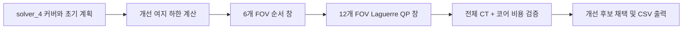

# yumin_solver_6

세 논문의 최적화 아이디어를 AOI에 맞게 변형한 실험 solver입니다. 기존 4번 solver로 커버와 초기 계획을 만들고, **짧은 구간의 스케줄 개선 + Laguerre 기저 QP 좌표 보정**을 수행합니다. 논문별 수식·페이지·적용 범위와 한계는 [PAPER_ANALYSIS.md](PAPER_ANALYSIS.md)에 정리했습니다.

## 실행

저장소 루트에서 실행합니다.

```bash
python3 2_run.py --solver yumin_solver_6
# 같은 의미의 별칭
python3 2_run.py --solver yumin6
```

`solve(data_folder: str) -> int`는 입력 폴더에 `output_fov.csv`를 쓰고 FOV 개수를 반환합니다. 표준 runner가 solver별 결과 폴더로 이동합니다. 외부 QP solver, GPU, 학습 모델, 네트워크 연결은 필요하지 않습니다. NumPy와 pandas를 사용합니다.

**의존성:** 커버·초기 계획·채점 모델은 `yumin_solver_4`를 import합니다. 이 폴더만 따로 복사하면 실행되지 않습니다. 제출 패키지에 `yumin_solver_4`도 포함해야 합니다. 5번의 학습된 시간 예산 모델에는 의존하지 않습니다.

## 알고리즘



1. 기존 minimum-piercing 커버·경로·재배정 파이프라인으로 실행 가능한 초기 해를 만듭니다. 기본 `bscale=0.8`입니다.
2. 부품 배정을 고정하고 이동을 0으로 완화한 하한으로 추가 개선 여지를 계산합니다. 여지가 0.02 이하이면 탐색을 생략합니다. 추가 탐색 시간은 `min(0.03초, 여지 × 0.4)`입니다. 이는 실행시간 비용을 줄이기 위한 휴리스틱이며 총점 개선 보장은 아닙니다.
3. 길이 6의 창을 앞으로 이동시키면서 같은 type 안의 relocation/reversal을 비교합니다. 전체 뒤쪽 계획을 유지하고 재구성·검사 부하까지 평가합니다. 후보의 스케줄 하한이 이미 나쁘면 가지치기합니다.
4. 길이 12, 간격 6의 겹치는 창에서 중심을 보정합니다. 축별 최대 4개의 누적 Laguerre 계수를 QP 변수로 쓰고 pole `{0, 0.5, 0.85}`를 시도합니다.
5. 작은 convex QP를 Hildreth 방식으로 풉니다. 라그랑주 쌍대 하한과 feasible primal 값을 함께 계산합니다. 다 풀리지 않아도 실행 가능한 후보만 사용합니다.
6. Fiducial과 oversized tile을 고정하고 나머지 중심을 부품 커버 사각형 안에 유지합니다. 수치적 내부 여유는 기본 `1e-7`입니다.
7. 정확한 대회 모델의 `min_k(CT + 10k)`가 감소할 때만 후보를 채택합니다. 실제 solver 실행시간은 이 채택 검사에 포함할 수 없으므로 별도 benchmark에서 합산합니다.

추가 시간 예산은 단계 사이에서 확인하는 soft deadline입니다. 이미 시작한 작은 QP·스케줄 계산, 통계 계산 등의 시간 때문에 조금 초과할 수 있습니다. 전체 solve 시간에는 초기 solver_4 시간도 포함됩니다.

## 논문과 구현의 차이

| 논문 아이디어 | 구현 |
|---|---|
| Weak-duality QP | 기존 선형 커버 제약으로 작은 QP 구성; 그 QP의 표준 라그랑주 dual gap 계산 |
| Laguerre MPC | 식 (17)의 기저 recurrence 및 누적 좌표 보정 |
| Pole optimization | 원문의 미분 기반 갱신 대신 3개 pole 후보 탐색 |
| Receding horizon | 전체 suffix 비용을 남겨 둔 오프라인 창 이동 |
| Tube MPC | 수치적 제약 여유만 차용; 외란 tube 및 폐루프 보장 없음 |

거리 제곱으로 만든 QP 비용은 채점 목적식의 대체식입니다. QP gap이 작다고 전체 커버·경로가 최적이라는 뜻은 아닙니다. 수치적 여유 역시 실제 장비의 위치 오차를 견딘다는 보장이 아닙니다.

## 실험 API

```python
from yumin_solver_6.solver import plan, LAST_STATS

rows, j = plan('simulation_data/S00_sparse_fast_001')
print(j, LAST_STATS)  # j는 CT + 10*core, 실행시간 제외

# 기능별 비교
rows, j = plan(folder, do_route=False)       # QP만
rows, j = plan(folder, do_qp=False)          # 순서 창만
rows, j = plan(folder, poles=(0.5,))         # 고정 pole
rows, j = plan(folder, basis_mode='full')    # 축별 전체 좌표 QP
rows, j = plan(folder, margin=0)            # 수치 여유 없음
rows, j = plan(folder, seconds=0)           # 초기 해만
```

`LAST_STATS`는 최근 호출의 진단용이며 동시 호출 결과 저장 용도가 아닙니다. `improve_rows()`는 동일한 초기 해를 기능별 실험에 재사용하며 `(rows, j, stats)`를 반환합니다. 시간 제한 기반이므로 같은 seed라도 머신 부하에 따라 결과가 조금 달라질 수 있습니다.

## 검증 및 재현

```bash
python3 -m unittest yumin_solver_6.test_solver -v
python3 -m yumin_solver_6.benchmark --data simulation_data --label practice
python3 -m yumin_solver_6.benchmark --data robustness_data/holdout_seed_51001 --label holdout
python3 -m yumin_solver_6.benchmark --data simulation_data --label ablation_final --ablation --limit 16
```

- Laguerre 직교성과 원문 미분 항등식을 수치 검사합니다.
- 작은 QP의 모든 active-set 조합으로 구한 해와 비교해 feasibility, primal/dual 방향, 최적비용을 확인합니다.
- 30개 무작위 병렬 스케줄을 공식 `Checker.get_real_cost`와 코어 수별로 비교하고 하한을 검증합니다.
- Fiducial 전용/중심/등록 순서, Barcode, Side, step, oversized tile을 포함한 회로를 공식 Checker로 확인합니다.
- 벤치마크는 임시 폴더에서 **penalty repair 없이 원본 출력**의 cover/order와 채점 일치를 확인합니다. Fiducial은 별도로 검증합니다. 기존 입력과 기존 solver 출력은 수정하지 않습니다.
- 같은 프로세스에서 5번과 6번 실행 순서를 회로마다 교대합니다. 실행시간에는 계획 생성 시간을 포함하고 검증·결과 보관 시간은 제외합니다. 따라서 CSV 파일 쓰기 시간까지 포함하는 `2_run.py`와는 소폭 차이가 있습니다.
- 원시 자료는 `results/<label>/comparison.csv`, 합계는 `totals.csv`, 개별 FOV는 회로별 하위 폴더에 저장합니다. 추가 탐색 시간은 `refinement_s`로 별도 확인할 수 있습니다.

## 실측 결과

2026-10-03, 동일한 환경에서 각 solver 1회 실행했습니다. 낮을수록 좋으며 실행시간을 포함합니다. 과거 저장된 5번 점수를 가져오지 않고 이번에 함께 다시 실행했습니다.

| 데이터 | 회로 수 | 5번 총점 | 6번 총점 | 개선 | 원본 출력 유효성 |
|---|---:|---:|---:|---:|---|
| 연습 | 96 | 12,740.03 | 12,737.13 | 2.90 (0.023%) | 96/96 통과 |
| 별도 seed 51001 | 96 | 13,719.56 | 13,715.14 | 4.42 (0.032%) | 96/96 통과 |

두 세트 모두 CT+코어 비용의 감소가 추가 실행시간을 상쇄했지만, 개선 폭은 작습니다. 개별 회로에서는 실행시간 증가 때문에 연습 세트 96개 중 28개, 별도 seed 세트 96개 중 24개만 총점이 개선됐습니다. 일부 회로의 큰 개선이 합계를 낮췄습니다. 반복 측정에 의한 통계적 우위나 비공개 평가 성능을 입증한 결과는 아닙니다. 별도 seed도 저장소에 이미 있던 공개 생성기 데이터이며 새로운 분포를 의미하지 않습니다.

[연습 세트 상세](results/practice/comparison.csv) · [별도 seed 상세](results/holdout/comparison.csv) · [실행 환경과 소스 해시](results/manifest.json)

### 기능별 비교: 동일한 초기 해, 16개 회로

8개 시나리오가 포함되도록 균등 간격으로 16개를 선택했습니다. 모든 실험에 동일한 초기 해를 넣어 초기 경로 차이의 영향을 줄였습니다. 각 모드의 시간 제한 안에서 탐색량은 달라지므로, 특정 수학적 요소만의 순수 인과 효과를 분리하는 실험은 아닙니다.

| 모드 | 총점 | 초기 해 대비 개선 |
|---|---:|---:|
| 초기 해 | 2,061.4346 | +0.0000 |
| 순서 창만 | 2,061.2140 | +0.2206 |
| Laguerre QP만 | 2,061.8732 | -0.4386 |
| 기본 조합 | 2,061.3246 | +0.1100 |
| 고정 pole 0.5 | 2,061.3114 | +0.1232 |
| 축별 전체 좌표 QP | 2,061.2443 | +0.1903 |
| 수치 여유 없음 | 2,061.3268 | +0.1078 |

이 소규모 실험에서 가장 효과적인 것은 **순서 창 탐색**이었습니다. QP 단독은 실행시간을 회수하지 못했고, 다중 pole이 고정 pole보다 총점에서 우수하다는 증거도 없었습니다. 수치 margin 유무는 CT에 차이를 만들지 않았습니다. 따라서 세 논문의 모든 요소가 각각 성능 향상에 기여했다고 주장할 수 없습니다. 기본 구현은 세 아이디어를 함께 검토하는 연구용 조합으로 두었으며, 점수 위주 실험은 `do_qp=False`로 분리할 수 있습니다.

두 96회로 세트에서 QP가 채택된 횟수는 각각 26회, 36회였지만, 제한된 반복 때문에 QP dual gap의 최댓값은 각각 약 122.73, 62.07이었습니다. 이는 대체 목적식 단위의 값입니다. 모든 QP가 최적해에 수렴한 것이 아니며, feasible 후보를 정확한 채점식으로 검증해서 사용했습니다.

[최종 기능별 비교 원시 자료](results/ablation_final/comparison.csv). `results/ablation`은 0.08초 예산·캐시 적용 전 개발 실험으로, 최종 코드의 수치와 구분해 보관했습니다. 최종 코드는 추가 탐색을 0.03초로 줄이고 작업·거리 데이터를 캐시합니다.
